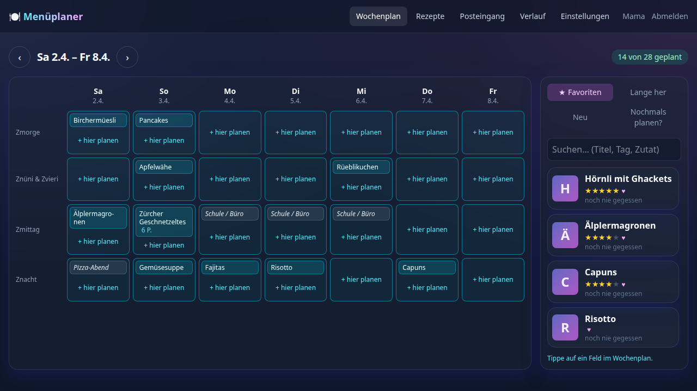
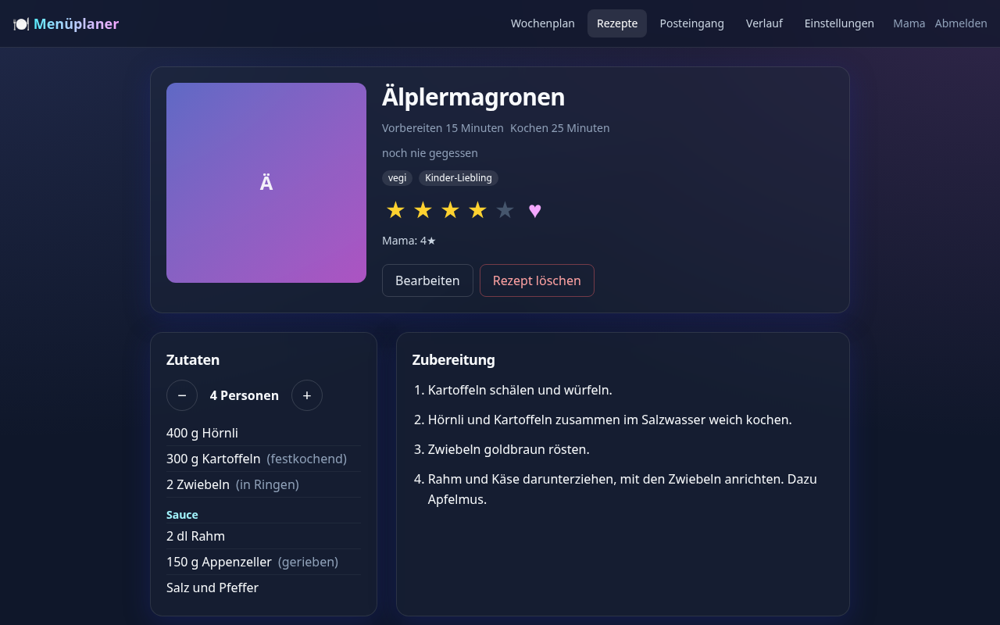
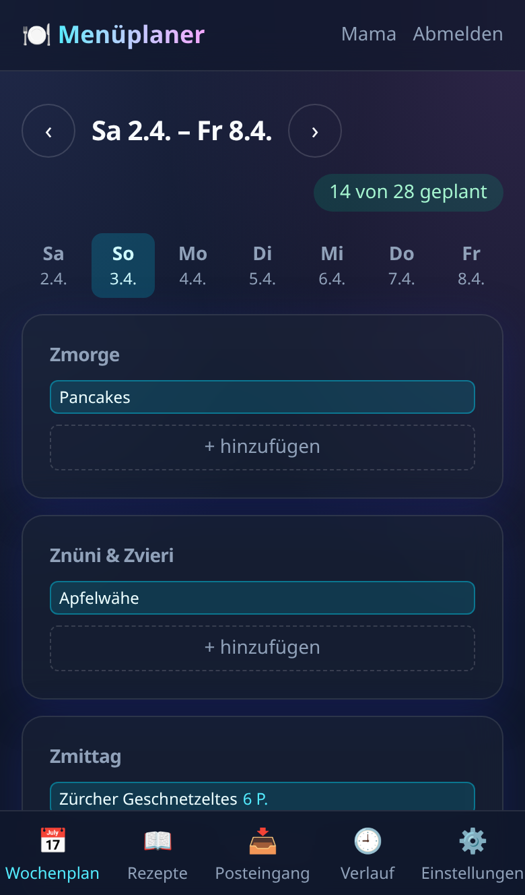

# Family Meal Planner

Plan the family's meals together every Friday, keep the recipe collection in one place, and see what you ate when.
Self-hosted on a NAS, a sibling of family-budget-dashboard and family-job-tracking (same stack, look and login).
German by default, English per person.



## Features

**Planning the week**
- The week on one screen, made for an iPad (10–15", landscape): seven days × Zmorge, Znüni & Zvieri, Zmittag and
  Znacht. The first day of the week is a setting (default Saturday, for Friday planning and weekend shopping).
- Suggestions next to the week: **★ Favoriten**, **Lange her** (well-liked dishes you haven't had for a while),
  **Neu** (saved but never cooked) and **Nochmals planen?** (planned, then skipped). Search by title, tag or
  ingredient.
- Tap a recipe, then tap a slot, or drag it there. Notes without a recipe ("Pizza-Abend", "Resten",
  "Schule / Büro") fit in a slot too.
- The number of people per meal (default: the family size). Empty slots are fine: about 70% planned is the idea, and
  the counter just says "14 von 28 geplant".
- On the phone: one day at a time, for adding something during the week.

**Recipes**
- Structured ingredients (amount, unit, name, note, groups like "Sauce"), steps, tags, a photo (picked, pasted or loaded from a link; iPhone HEIC works).
- Scaled to any number of people, rounded the way people measure ("½ l", "1½ Eier", "350 g").
- Ratings and favourites per person, so you see what everyone likes.
- Where it comes from: a link to the original page (editable), and who sent it in by mail, and when.

**Closing the week and history**
- On Friday the planner offers to close the past week: untick what you didn't eat, note what you had instead, rate
  what you ate.
- History of past weeks, and per recipe when it was last eaten and how often.

**Getting recipes in**
- **By mail:** share a Facebook post, a screenshot or a link to `rezepte@<your domain>` (Cloudflare Email Worker).
  Only registered family addresses are accepted.
- **By photo:** on the Rezepte page, photograph a recipe (the back of a pack, a cookbook page), one or several
  photos per recipe. A parent's photos are read by the AI at once; a child's wait in the Posteingang.
- **By link:** on the Rezepte page or in the Posteingang, paste a recipe page (Swissmilk, Fooby, Betty Bossi, most blogs). Their built-in recipe data is read
  without any AI.
- **Nothing is read before a parent taps "Verarbeiten".** Then links are followed, and only if needed the AI
  (Infomaniak) reads the page or the screenshots. The result is a draft with unclear spots listed, checked before it
  is saved; the original mail stays available.
- AI translation of a recipe into German, with the original kept.

**Family and costs**
- One login for the family through the family hub (FrankAndreas/family-hub), with parent and child roles. Children
  plan, add and rate recipes; only parents process imports, use the AI, delete recipes and change settings.
- AI calls are limited per person and hour, at most 10 pictures per call, and parents see each person's calls per
  month. Set a spending limit at Infomaniak as the outer limit.

<p>
  
  
</p>

## Running it

The app runs as two Docker containers (FastAPI backend with SQLite, nginx with the React frontend) on port 8085.
Installation on a Synology NAS, HTTPS at home, recipe mails, the AI and automatic updates:
[`README_DOCKER.md`](README_DOCKER.md).

Background: the design in [`docs/superpowers/specs/`](docs/superpowers/specs/2026-10-29-meal-planner-design.md), the
implementation plans in [`docs/superpowers/plans/`](docs/superpowers/plans/), and decisions and known minor issues in
[`docs/superpowers/build-notes.md`](docs/superpowers/build-notes.md).

## Development

```bash
python3 -m venv venv
venv/bin/pip install -r backend/requirements.txt -r tests/requirements.txt
scripts/dev-backend.sh                      # API on :8000, database in backend/data; logins from a family hub on :8086
cd frontend && npm install && npm run dev   # app on :5173, /api forwarded to :8000
```

## Tests

```bash
venv/bin/pytest                                      # backend
cd frontend && npm test && npm run lint && npm run build
cd e2e && E2E_PYTHON=../venv/bin/python npm test     # browser tests, see e2e/README.md
cd cloudflare/email-worker && npm ci && npm test     # the mail worker
```

Visible texts live in `frontend/src/locales/{de,en}.ts`; `npm run lint` fails on text written directly in components.

## License

MIT, see [`LICENSE`](LICENSE).
